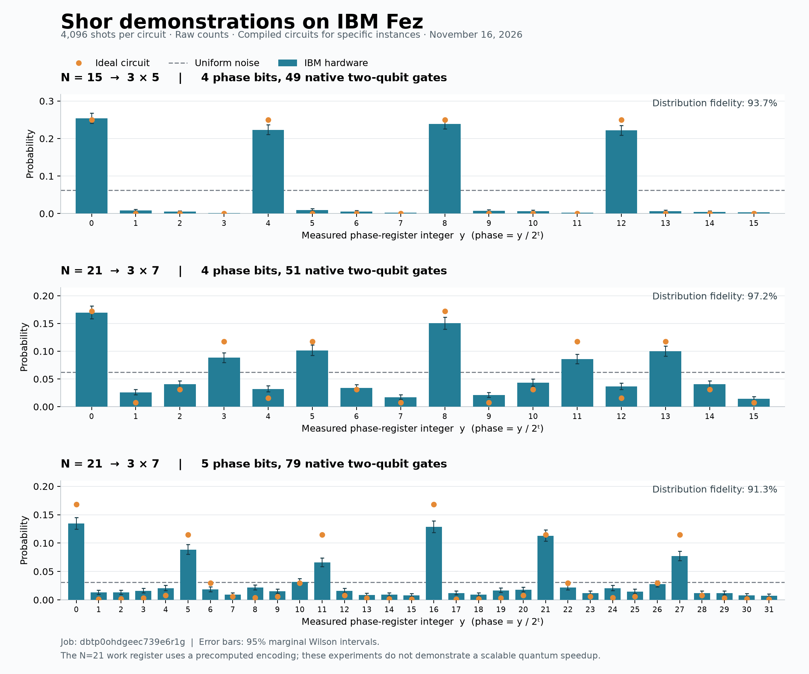

# Shor demonstrations on IBM Quantum

**Both 15 and 21 were factored on `ibm_fez` on November 16, 2026.**
The batch used 4,096 shots per circuit and 5 seconds of QPU charge time on
the IBM Open Plan. Job ID: `dbtp0ohdgeec739e6r1g`.

| Instance (base 2) | Counting + work qubits | Native CZ gates | Recovered factors | Distribution fidelity |
| --- | ---: | ---: | --- | ---: |
| 15 | 4 + 4 | 49 | 3 × 5 | 93.68% |
| 21 | 4 + 3 | 51 | 3 × 7 | 97.16% |
| 21 | 5 + 3 | 79 | 3 × 7 | 91.28% |

The fidelity here is the **classical distribution fidelity**
`(sum(sqrt(p_measured * p_ideal)))**2`, not quantum-state or gate fidelity.
All three experiments passed the predeclared checks described below. The
smaller 21 circuit performed better in this batch; one batch does not
establish that this ordering will persist across calibrations.



The [experiment report](results/ibm_fez_2026-11-16/REPORT.md),
[raw counts](results/ibm_fez_2026-11-16/raw_counts.json),
[analysis](results/ibm_fez_2026-11-16/analysis.json), and
[preparation manifest](results/ibm_fez_2026-11-16/prepare.json) are saved in
the repository. `circuits.qpy` contains the exact submitted ISA circuits.

## What was optimized

[`hardware_circuits.py`](shors_algorithm/hardware_circuits.py) contains two
**compiled, instance-specific demonstrations** with base 2:

- **15:** The work register remains ordinary four-bit binary. Starting from
  `|1>`, the first controlled multiplier reduces to two CX gates. The next
  power uses two controlled swaps; the remaining modular powers are identity.
- **21:** Its six reachable residues are represented by three work qubits:
  one parity bit and a two-qubit three-state cycle. Pairs of relative-phase
  Toffoli gates implement that cycle; reversing a pair implements its inverse.
  Their phases define a consistent encoding and are checked explicitly.
  The first step simplifies because the work input is known.

The 21 encoding is **precomputed and contains order information**. This is a
hardware demonstration of the phase-estimation/order-finding circuit and its
classical factor extraction, not a scalable factoring algorithm or evidence
of quantum computational advantage. The full binary reference is retained
for independent correctness checks. Tests verify the modular value and
encoding phase for every exponent, then compare the entire measured phase
distribution with that reference.

With the same precision, base, all-to-all `u`/`cx` basis, Qiskit 2.6.2,
optimization level 3, and transpiler seed 7:

| Instance | Generic permutation CX count | Compiled CX count |
| --- | ---: | ---: |
| 15, 4 counting bits | 1,292 | 28 |
| 21, 4 counting bits | 5,640 | 29 |
| 21, 5 counting bits | 6,992 | 41 |

Device routing adds gates; the first table gives the **actual submitted CZ
counts**. Preparation compares four transpiler seeds and chooses a circuit
using a calibration-error cost, with gate count and depth as tie breakers.
This cost is a layout-ranking heuristic, not a predicted success probability.

## Install and run locally

Python 3.10 or newer is required. The hardware results used Python 3.14.6,
Qiskit 2.6.2, and Qiskit IBM Runtime 0.52.1.

```sh
python3 -m venv .venv
source .venv/bin/activate
python -m pip install -e '.[dev,ibm,noise,notebook]'
python -m pytest -q
```

The complete suite has 145 tests. An ideal local run of the small compiled
circuits needs no IBM account:

```python
from qiskit.primitives import StatevectorSampler
from shors_algorithm.hardware_circuits import compiled_order_finding_circuit
from shors_algorithm.verification import analyze_counts

qc = compiled_order_finding_circuit(21)  # 5 counting + 3 encoded work qubits
counts = StatevectorSampler(seed=7).run([qc], shots=4096).result()[0].data.phase.get_counts()
report = analyze_counts(counts, 21, qc.num_clbits)
print(report['factors'], report['passed'])  # [3, 7], True
```

The [reference notebook](shors_algorithm/generalized_shor.ipynb) and CLI
use the larger, generated multiplier for arbitrary small coprime bases:

```sh
python -m shors_algorithm --number 21 --base 2
python -m shors_algorithm --number 15 --base 7
```

That reference defines `|x> -> |a*x mod N>` for `x < N` and fixes unused
states. It synthesizes cycles of basis-state permutations with exact
multi-controlled X gates. Synthesis is exponential in the modulus bit
length; it is a useful small-instance reference, not efficient reversible
arithmetic. The CLI is limited to `N <= 31` and 12 counting qubits. Both
implementations use one specified base; neither is a full recursive driver
with primality/perfect-power checks and automatic base retries.

## IBM hardware

The runner loads an existing saved `QiskitRuntimeService` account and limits
instance selection to the **Open Plan**. If needed, configure a local account
with hidden token input (do not paste tokens into source or notebooks):

```python
from getpass import getpass
from qiskit_ibm_runtime import QiskitRuntimeService

QiskitRuntimeService.save_account(
    channel='ibm_quantum_platform', token=getpass('IBM API key: '),
    set_as_default=True,
)
```

Prepare a **new** experiment directory. Preparation reads current device
calibrations, compiles the three circuits, enforces a 200 two-qubit gate/depth
budget, saves exact QPY circuits and metadata, and optionally runs a local
calibration-based noise simulation. It does not submit a job:

```sh
python -m shors_algorithm.hardware prepare results/my_run --backend ibm_fez --shots 4096 --noise-sim
```

Submit the prepared batch, then collect its result:

```sh
python -m shors_algorithm.hardware submit results/my_run
python -m shors_algorithm.hardware collect results/my_run
```

`submit` spends QPU time, uses a 120-second execution cap, and immediately
saves the job ID. It refuses a second submission in a directory with a
recorded job. `collect` returns exit code 2 if the job is queued/running;
run `collect` again later, **not** `submit`. The API key never enters experiment
artifacts. Device availability and calibrations change over time.

The saved results can be plotted offline:

```sh
python scripts/plot_hardware_results.py results/ibm_fez_2026-11-16
```

## What counts as a successful hardware demonstration

A noisy histogram can yield correct factors for these small numbers by
chance. [`verification.py`](shors_algorithm/verification.py) therefore
requires all three conditions, fixed before submission:

1. Continued-fraction/LCM post-processing recovers a verified even period
   yielding a checked nontrivial divisor pair.
2. Total variation distance to the ideal distribution is smaller than the
   distance to uniform noise.
3. A one-sided Monte Carlo test rejects the uniform null at `p < 0.01`,
   using projection along `ideal - uniform` and 10,000 null samples.

All measurement outcomes are retained. There is no postselection, filtering
of unfavorable outcomes, or local readout correction. The uniform-null test
assumes independent shots and tests one noise model; it is not a test against
all classical explanations or an entanglement witness. Runtime execution
metadata is retained with the raw counts.

For 21 with four counting bits, **multiple outcomes must be combined**:
individual continued-fraction denominators 2 and 3 yield 6 through their LCM.
No individual outcome in that experiment recovers factors by itself. With
five counting bits, 16.58% of the actual shots individually produced a
validated period yielding factors. Counts are frequencies, while phases are
`int(bitstring, 2) / 2**counting_qubits`. Every accepted period satisfies
`pow(a, r, N) == 1`; factor extraction rejects odd periods and
`pow(a, r//2, N)` equal to ±1 modulo N.

## Next steps and references

For a scalable multiplier, replace basis enumeration and the special orbit
encoding with reversible modular addition and uncomputation. For these
hardware demonstrations, useful next experiments are repeat batches across
calibrations, additional bases, and comparison with iterative phase
estimation to trade mid-circuit operations against routing cost.

- [IBM Shor tutorial](https://quantum.cloud.ibm.com/docs/en/tutorials/shors-algorithm)
- [Skosana and Tame: compiled demonstration for 21](https://arxiv.org/abs/2103.13855)
- [Beauregard: Shor's algorithm using 2n+3 qubits](https://arxiv.org/abs/quant-ph/0205095)
- [IBM Runtime primitives](https://quantum.cloud.ibm.com/docs/en/api/qiskit-ibm-runtime/runtime-service)
- [IBM account configuration](https://quantum.cloud.ibm.com/docs/en/ibm-quantum-compute/save-credentials)
