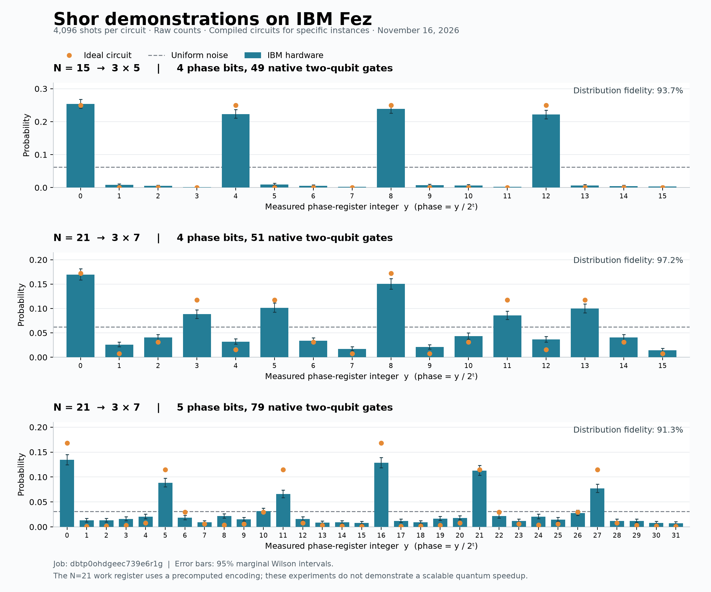

# IBM hardware verification: 15 and 21

Both integers were factored using measurements from **ibm_fez**, with the full raw histograms also passing the predeclared distribution checks.

- Job: `dbtp0ohdgeec739e6r1g`
- Completed: November 16, 2026 at 06:23:23 PM EST
- IBM plan: Open
- Shots: 4,096 per circuit; 12,288 total
- QPU charge time reported by IBM: 5 seconds
- Runtime: 0.52.1; Qiskit: 2.6.2
- No postselection or local readout correction. Runtime metadata confirms gate/measurement twirling and dynamical decoupling were disabled.

| N | Counting bits | Total logical qubits | CZ count / depth | Factors | Classical fidelity | TVD to ideal | TVD to uniform | Pass |
| --- | ---: | ---: | ---: | --- | ---: | ---: | ---: | --- |
| 15 | 4 | 8 | 49 / 39 | 3 × 5 | 0.9368 | 0.0667 | 0.6875 | True |
| 21 | 4 | 7 | 51 / 47 | 3 × 7 | 0.9716 | 0.1189 | 0.3208 | True |
| 21 | 5 | 8 | 79 / 66 | 3 × 7 | 0.9128 | 0.2077 | 0.4207 | True |

## Interpretation

The smallest supported verified periods include 4 for base 2 modulo 15 and 6 for base 2 modulo 21. Larger multiples also occur among candidates because the raw histograms contain noise. Factor extraction verifies each candidate with modular exponentiation before computing GCDs.

For 15, the factors follow from gcd(2² − 1, 15) = 3 and gcd(2² + 1, 15) = 5. For 21, they follow from gcd(2³ − 1, 21) = 7 and gcd(2³ + 1, 21) = 3.

The four-bit 21 run combines reduced denominators across outcomes (LCM(2, 3) = 6); no individual outcome alone yields factors with this postprocessor. The five-bit run also supports direct recovery: 679 of 4,096 shots (16.58%) individually produce a verified period yielding factors.

Classical fidelity measures similarity between probability distributions. It is not quantum-state or gate fidelity, and a high value alone is insufficient: each run also had to be closer to its ideal distribution than to uniform noise in total variation. All three passed the one-sided uniform-null Monte Carlo test with 0 of 10,000 null draws at or above the observed statistic (plus-one p estimate ≈ 0.00010). The test assumes independent shots and does not exclude every classical explanation.

## Scope of the circuit optimization

These are **compiled demonstrations for particular instances**. The 15 circuit retains a four-qubit binary work register. The 21 circuit encodes the six already identified orbit values into three qubits, with phases explicitly included in the encoding. That precomputation contains order information; the result is not a demonstration of a scalable Shor implementation or a quantum speedup.

Complete input-by-input statevector tests establish that the compiled modular exponentiation agrees with the original modular function under this fixed encoding. Independent tests compare the entire phase distribution against the generic five-work-qubit circuit for 21. Replacing relative-phase Toffoli gates without this consistency check would generally be invalid.

The four-bit 21 circuit used fewer gates and produced a distribution closer to ideal in this batch. The five-bit circuit provides better phase resolution and direct single-outcome period recovery. Repeated batches would be needed to characterize stability across calibrations.

## Reproducibility artifacts

- [prepare.json](prepare.json): calibration timestamp, seed candidates, chosen physical layouts, exact gate counts, software versions, circuit/source hashes, and verification rule saved before submission.
- [circuits.qpy](circuits.qpy): exact submitted ISA circuits, in table order.
- [job.json](job.json): job identifier, backend, and submission timestamp.
- [raw_counts.json](raw_counts.json): all observed counts, IBM timestamps/usage, and actual Runtime options.
- [analysis.json](analysis.json): ideal probabilities, recovered periods/factors, metrics, and pass results.
- [noise_simulation.json](noise_simulation.json): local prediction using device calibration data, explicitly separate from hardware results.
- [phase_distributions.svg](phase_distributions.svg): exportable plot.

Use the commands in the [repository README](../../README.md) to prepare a new batch or plot these saved data. The 145-test suite checks full multipliers, compiled exponentiation including phases, phase distributions, failure modes, and rejection of uniform-noise histograms even when those histograms return the correct factors.
